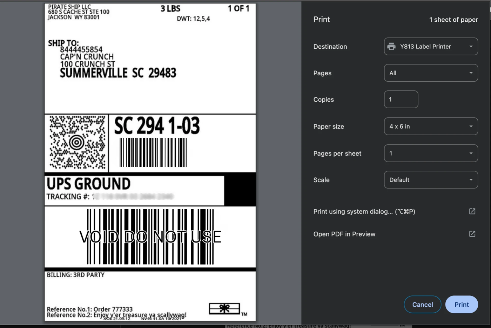
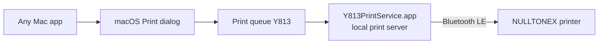

# NULLTONEX Label Printer Bluetooth Driver for Mac

[](https://github.com/DaveLinger/nulltonex-bluetooth-mac/releases/latest)

[](LICENSE)

Print 4×6 shipping labels to a **NULLTONEX thermal label printer over Bluetooth**, straight from the normal Print dialog on your Mac. It works with labels from Pirate Ship, Shopify, Etsy, eBay, Amazon, USPS, UPS, FedEx or anywhere else that gives you a 4×6 PDF. You don't need a USB cable, and you don't need the FlashLabel Pro or Pixmate app.

It works as a **NULLTONEX Bluetooth printer driver for macOS**: once installed, your Mac has a printer called **Y813 Label Printer**. Print a label to it like any other printer, and it comes out at the printer's full 203 dpi.



## Install

Open **Terminal** (Applications → Utilities → Terminal), paste this line and press Return:

```bash
curl -fsSL https://raw.githubusercontent.com/DaveLinger/nulltonex-bluetooth-mac/main/install.sh | zsh
```

When macOS asks whether **Y813 Print Service** may use Bluetooth, click **Allow**. Then turn the printer on and print.

> [!TIP]
> There's no Bluetooth pairing. Don't pair the printer in System Settings: the Mac finds it by itself each time you print.

**You need:**
- a Mac with Bluetooth, Intel or Apple Silicon (developed on macOS 27; earlier versions untested)
- an admin account (to add the printer)
- a NULLTONEX 4×6 Bluetooth label printer with 100 × 150 mm (4×6) labels. See [Is my printer supported?](#is-my-printer-supported)

<details>
<summary>What the installer does</summary>

1. Downloads the latest release of **Y813PrintService.app** to `~/Applications`.
2. Asks macOS for Bluetooth permission.
3. Starts a small background service that runs at login.
4. Adds a printer called **Y813 Label Printer**.

No developer tools are needed. The app is open source and ad-hoc signed, not signed with a paid Apple Developer ID, which is why it's installed from Terminal: a double-clicked download would be blocked by Gatekeeper.
</details>

<details>
<summary>Update or uninstall</summary>

Run the install command again to update. To remove the printer, the background service and the app:

```bash
curl -fsSL https://raw.githubusercontent.com/DaveLinger/nulltonex-bluetooth-mac/main/install.sh | zsh -s -- --uninstall
```
</details>

<details>
<summary>Install without piping a script into your shell</summary>

Download `install.sh` and `Y813PrintService.zip` from the [latest release](https://github.com/DaveLinger/nulltonex-bluetooth-mac/releases/latest), read the script, then run:

```bash
zsh ~/Downloads/install.sh --app ~/Downloads/Y813PrintService.zip
```
</details>

## Printing

1. Turn the printer on.
2. Open the label PDF and choose **Print**, then **Y813 Label Printer**.
3. Leave **Paper size** at **4 × 6 in** and scaling at **Default** (100 %). Don't choose "fit to page": the printer service does its own fitting.
4. Optional: **Print Quality** sets how dark the label prints.

| Print Quality | Darkness |
|---|---|
| Draft | Light |
| **Normal** (default) | Medium |
| High | Dark |

> [!NOTE]
> Chrome's own print preview doesn't show Print Quality. Click **Print using system dialog… (⌥⌘P)** to get it.

**Label fitting.** Shipping label PDFs are 4 × 6 in (101.6 × 152.4 mm), slightly bigger than the printer's 100 × 150 mm labels. Labels print at exactly 100 % when they fit. If something near the edge would be cut off, the whole label is shrunk evenly just enough to fit, usually to about 98 %. Pages that aren't 4×6 (such as a full Letter sheet) are refused instead of printed wrong. [More detail](docs/rendering.md).

## Is my printer supported?

It was built for and tested with the printer Amazon sells as the **NULLTONEX Thermal Shipping Label Printer 4x6, Bluetooth** ([B0DX6RVJF7](https://www.amazon.com/dp/B0DX6RVJF7)). Its Bluetooth name starts with **`Y813_`**. You can see that name in the FlashLabel Pro or Pixmate app, or in a free Bluetooth scanner app such as LightBlue.

Other printers that show up as `Y813_…` should work too. Some label printers are sold under several brand names with the same insides, so if yours has a different name and works, or doesn't, please [open an issue](https://github.com/DaveLinger/nulltonex-bluetooth-mac/issues) with the brand and its Bluetooth name.

## FAQ

**Can I print to a NULLTONEX label printer from a Mac over Bluetooth?**
Yes, that's what this does. The vendor's Mac support uses a USB cable and driver. This adds Bluetooth printing from any Mac app.

**Do I need the FlashLabel Pro or Pixmate app?**
No. You don't need either app, at install time or afterwards.

**Does it work with Pirate Ship, Shopify, Etsy, eBay, USPS, UPS or FedEx labels?**
It prints any 4×6 label PDF, whoever made it. It's been tested with Pirate Ship UPS labels.

**Does it work over USB?**
No, this project is Bluetooth only. Use the manufacturer's driver for USB.

**Can someone else print to my printer?**
The printer doesn't use Bluetooth pairing, so anyone within Bluetooth range (about 10 m) can send it a job while nothing else is connected to it. That's how the printer works with any app. The practical risk is wasted labels, since the printer stores no data.

## Troubleshooting

- **"Printer not found":** the printer is off or out of range, or another device is connected to it.
- **Only one connection at a time:** the printer accepts a single Bluetooth connection. If another device or app, such as a phone, is connected to it, the Mac can't reach it. Disconnect the other device and print again. This service connects only while a job is printing, so it won't block other devices between jobs.
- **"Bluetooth permission not granted" or "timed out waiting for Bluetooth":** turn on **Y813PrintService** in System Settings → Privacy & Security → Bluetooth, then run the install command again.
- **A failed label never reprints on its own.** The service retries only failures that happened before any data was sent, so a paid label can't print twice.
- **Log:** `~/Library/Logs/Y813PrintService.log` records each job's size, scaling and Bluetooth steps. It never records label contents.

## How it works



The app is a small local print server that macOS treats as an ordinary network printer (IPP Everywhere). macOS hands it the label PDF. It renders the PDF at the printer's 203 dpi and sends it to the printer over Bluetooth LE in the printer's own TSPL format.

| Doc | Contents |
|---|---|
| [docs/protocol.md](docs/protocol.md) | The printer's Bluetooth protocol: ISSC UART service, TSPL with zlib `BITMAP` mode 3, inverted bit polarity, pacing, status |
| [docs/architecture.md](docs/architecture.md) | Why it's a local IPP printer app, what the service does, and its guarantees |
| [docs/rendering.md](docs/rendering.md) | Label geometry, crop/shrink policy, test fixtures |
| [docs/gatt-map.md](docs/gatt-map.md) | The printer's GATT table |
| [docs/app-inspection.md](docs/app-inspection.md) | What the Pixmate app's binary revealed (static strings only) |
| [docs/capturing.md](docs/capturing.md) | How the protocol was captured with PacketLogger, and how to reproduce it |

Tested on macOS 27.0.1 (Apple M2) with a `Y813_XXXX_BLE` printer and 100 × 150 mm labels, printing from Chrome, Preview and `lp`.

## Development

```
install.sh        installer (downloads the release, or --from-source)
macos/            Swift print service (build.sh, Sources/)
src/y813/         Python reference: tspl.py (encoder), raster.py (PDF → raster), ble.py (bleak sender)
scripts/          y813_print.py (PDF → job / send), research tools (recon, pklg extractor, TSPL decoder, fixtures)
tests/            unittest suite; tests/golden/ holds the byte streams the vendor app sent (test images only)
fixtures/         generated test labels
```

Building from source needs the Xcode Command Line Tools (`xcode-select --install`):

```bash
git clone https://github.com/DaveLinger/nulltonex-bluetooth-mac.git && cd nulltonex-bluetooth-mac
./install.sh --from-source                      # build this checkout and install it

python3 -m venv .venv && .venv/bin/pip install -r requirements.txt
macos/build.sh                                  # universal app (add "native" for a faster single-arch build)
.venv/bin/python -m unittest discover -s tests
```

The Swift encoder must stay byte-identical to the vendor app's captured jobs and to the Python encoder, and the renderers must agree (`tests/test_swift_port.py`). Three optional tests use Pirate Ship's sample UPS label. Save it as `fixtures/pirateship-ups-void-4x6.pdf` to enable them; it isn't redistributed here.

Python scripts that use Bluetooth must run from **Terminal.app**, not from a shell inside another app (an IDE or agent), or macOS kills them. See [docs/capturing.md](docs/capturing.md).

**Releases:** bump `VERSION`, commit, then push a matching tag (`git tag v0.1.1 && git push --tags`). GitHub Actions builds the universal app, runs the tests, and publishes `Y813PrintService.zip` and `install.sh`.

## Disclaimer

This is an independent project, not affiliated with or endorsed by NULLTONEX, the makers of FlashLabel Pro or Pixmate, Pirate Ship or any carrier. The protocol was worked out for interoperability from the printer's own Bluetooth traffic. No vendor app was modified or decompiled, and no firmware was touched. Use at your own risk.

## License

[MIT](LICENSE)
